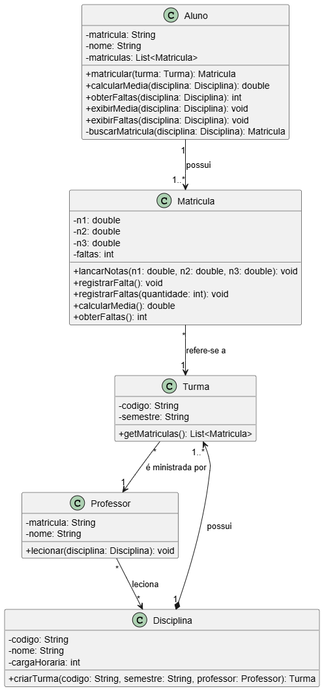

# Análise e Projeto de Sistema Acadêmico

Modelo de classes de projeto e implementação em Java de um sistema acadêmico, desenvolvido como atividade da disciplina  ANÁLISE E PROJETO DE SISTEMAS ORIENTADOS A OBJETOS na UFERSA.

## Objetivo

Modelar e implementar um sistema que permite o cadastro de disciplinas, alunos, professores e turmas, o registro de faltas e o cálculo da média do aluno.

## Requisitos

- Cadastro de disciplinas, alunos, professores e turmas
- Registro de faltas
- Cálculo da média do aluno

## Regras de negócio

- Cada aluno está matriculado em várias disciplinas
- Cada professor pode lecionar várias disciplinas
- Cada disciplina tem várias turmas
- Média: `M = (n1 + n2 + n3) / 3`

## Diagrama de classes



O código-fonte do diagrama em PlantUML está em `diagrama/diagrama.puml`.

## Estrutura do projeto

```
.
├── academico/        # Código Java (Aluno, Matricula, Turma, Disciplina, Professor, Main)
└── diagrama/         # Diagrama de classes (PNG e PlantUML)

```

Saída esperada do exemplo em `Main`:

```
Aluno: Maria Souza | Disciplina: Programação Orientada a Objetos | Média: 8,00
Aluno: Maria Souza | Disciplina: Programação Orientada a Objetos | Faltas: 3
```

## Discente

Janieli Tainar da Silva
